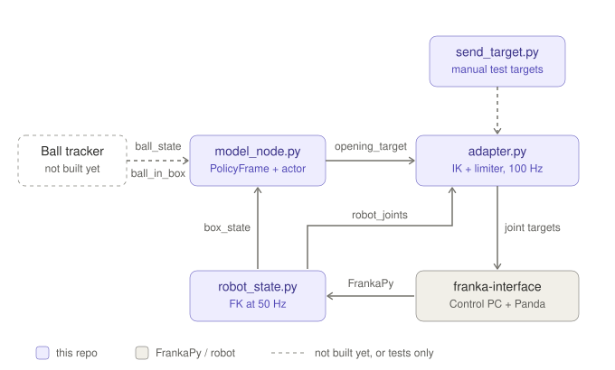
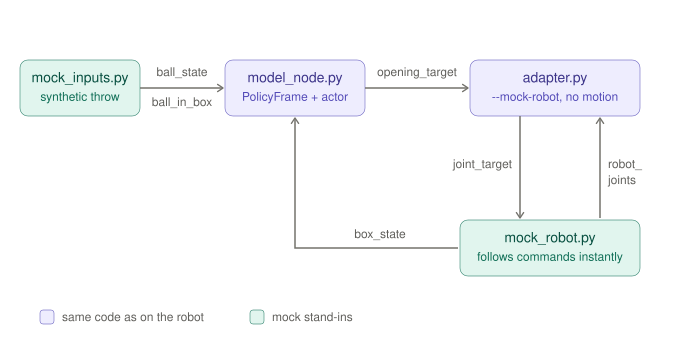

# Franka ball-catching simulation

A MuJoCo / robosuite simulation of a Franka catching a table-tennis ball in a 3D-printed box. The gripper holds the box handle; a CrossQ policy proposes a box-opening position, which is converted to joint targets using inverse kinematics.

**Robot control runs in simulation.** The standalone RealSense tracker reports ball position and velocity in camera coordinates or in the Franka base frame with a supplied calibration.

## Model and results

The new [steady-motion model](docs/STEADY_MOTION.md) and its CPU actor are also included. The ROS model node loads the steady-motion actor; the real camera publisher and hardware integration still need validation.

The original model is `artifacts/limited-thin-model/final_model.zip`. It was trained from scratch for 50,000 decisions using the thin box, a 20 ms decision interval, and joint targets for joints 1, 4 and 6. On 50 held-out simulated throws, the ball entered on 50 and remained in the box for one second on 49. On 20 harder throws aimed near opposite sides of the workspace, the corrected metric measured 13 retained catches. These results use exact simulated ball tracking and an ideal rigid grasp.

**The 20 cm radius constrains predicted landing points and desired opening targets, not the actual robot or its swept volume.** In the edge test the opening itself went outside the sphere. This is not a hardware safety boundary; a separately validated safety controller and collision checks are required.

The printed source is `assets/armbox-thin.STL`; `assets/armbox-thin-meters.STL` is the transformed rendering mesh. Five boxes approximate its non-convex cavity for collisions. The internal opening is approximately 13.5 × 13.5 cm, with 9.5 cm internal depth. Box and handle mass is assumed to be 250 g; the grasp is rigid and cannot slip.

The earlier 300,000-step seven-output residual model and its original-box results remain in `artifacts/original-model/`. It uses a different observation and box geometry.

### Run a rollout

```sh
python3 scripts/run_rollout.py                 # MuJoCo viewer, current model
python3 scripts/run_rollout.py --no-view       # headless
python3 scripts/run_rollout.py --model original  # earlier model and box
```

On macOS, the MuJoCo viewer may require `mjpython scripts/run_rollout.py`. `scripts/train_limited_thin_50k.py` starts a new training run and refuses to overwrite an existing run.

## Install and test

Requires Python 3.11 or 3.12. From this directory:

```sh
python3 -m venv .venv
source .venv/bin/activate
python3 -m pip install -e '.[training]'
python3 -m pip install pytest pillow
python3 -m pytest -q
```

The offline video renderer also requires `ffmpeg` on `PATH`. Lock files record packages from the original environment and may require adaptation for a different platform.

## Camera tracking

Use `check_camera.py` to inspect the RealSense streams and `track_ball.py` to track a white table-tennis ball. The [camera implementation guide](docs/CAMERA_IMPLEMENTATION.md) describes the planned calibration and controller integration.

### RealSense D435 terminal check

Use Python 3.11 or 3.12 in a camera-only virtual environment. Connect the camera
to a USB 3 port and run these commands from the repository root:

```sh
python3 -m venv ~/.venvs/catchbox-camera
source ~/.venvs/catchbox-camera/bin/activate
python3 -m pip install -r requirements-camera.txt
python3 scripts/check_camera.py --seconds 10
python3 scripts/check_camera.py --preview
```

The script prints the device and active stream profiles, then reports paired
frame rate and median depth in a 5 × 5 patch at the center of the RGB image.
Point the camera at a flat target and check that the reading follows a known
change in distance. Zero depth pixels are skipped. RGB–depth timestamp skew is
reported when both frames use the SDK's global timestamp domain. Omit
`--seconds` to run until Ctrl+C.

With `--preview`, a window shows RGB on the left and colorized depth aligned
to RGB on the right. Black areas in the depth view have no valid depth. Press
`q` or Esc in the window to stop. The terminal readings continue during preview.

On Linux, if USB enumeration sees the camera but the SDK cannot access it,
check the [RealSense Linux device permissions and udev instructions](https://github.com/realsenseai/librealsense/blob/master/doc/distribution_linux.md).
The Python package needs a compatible wheel for your platform. See the
[RealSense Python SDK installation guide](https://github.com/realsenseai/librealsense/blob/master/wrappers/python/readme.md)
for supported environments.

### Track a white table-tennis ball

```sh
python3 -B scripts/track_ball.py --preview --every-frame --seconds 10
```

The tracker requests 640 × 480 RGB and depth at 60 fps over USB 3. It prints
the active profiles and measured rate of fresh RGB-D pairs at normal exit.
Use `--fps 30` if the camera or connection cannot sustain 60 fps.

Keep the camera fixed and move the ball against a darker background. The
tracker looks for a bright, moving, round region. A green circle indicates a
valid camera-frame XYZ estimate. A yellow circle indicates a 2D detection with
unusable depth or timing. The tracker accepts surface depths from 0.3 to 3 m.
The terminal prints the camera timestamp, pixel center, and XYZ in meters
when available, or a reason the depth estimate was rejected. Use `--every-frame`
to log each fresh pair and `--brightness` to adjust the detection threshold.
Omit `--seconds` for a continuous preview. Press `q` or Esc to exit.

Position and velocity use the D435 optical frame, with axes pointing right,
down, and forward. After at least four valid positions over at least 45 ms,
the tracker fits velocity in m/s from the most recent 150 ms of capture times.
It restarts the fit after a gap longer than 75 ms or when positions disagree
with the fit by more than 3 cm. `valid=True` means the current XYZ is usable.
`velocity=unavailable` means the tracker is still gathering consistent
measurements for the fit.

When velocity is available, the terminal also prints a 50 ms straight-line
look-ahead in the camera frame. The ballistic prediction of where the ball
crosses the box opening will use the camera-to-Franka calibration and the
opening height.

To follow the code, start with `track()` in [track_ball.py](scripts/track_ball.py).
It reads each fresh pair, calls `detect_ball()` for the 2D candidate, then calls
`describe_detection()` to check timing and recover XYZ from aligned depth.
`MotionHistory` fits velocity from the valid timestamped positions.
[check_camera.py](scripts/check_camera.py) owns the shared camera startup and
cleanup and can also be run by itself to inspect the raw streams.


### Report ball coordinates in the Panda base frame

To collect points with the Panda, fix a white 40 mm table-tennis ball to the
box where the RealSense can see it. Keep the camera fixed and use its RGB
stream.

```sh
python -B scripts/calibrate_camera_live.py --robot manual --preview
```

At each stationary pose, press Enter and paste the 16 numbers from the
Panda's measured `O_T_EE`. If your ROS 1 workspace already publishes arm
state, the calibrator can read it directly. For example, with Franka Interface:

```sh
python -B scripts/calibrate_camera_live.py --robot ros --preview \
  --ros-topic /robot_state_publisher_node_1/robot_state
```

Record 10-15 poses spread across the catch area.
Tilt the wrist about different axes at several poses so the solver can
separate the ball offset from camera translation. If the ball center has
a measured offset in the end-effector frame, supply `--ball-offset X Y Z`
in meters. Type `solve` and review the leave-one-out errors. The live tool
saves `calibration/camera_to_base.json` by default. Check additional points
near the catch zone before using that transform to guide motion.

#### Fit from surveyed points

Keep the camera fixed. From the camera environment, open the RGB preview
and click a stationary mark on a flat, matte surface.

```sh
python -B scripts/check_camera.py --sample-points
```

For each mark, record the printed camera XYZ and the XYZ of that **same
physical point** in the Panda base frame, both in meters. Use surveyed
reference points or a fixture whose marked point has a known robot-base
position. A flange or TCP reading is usable directly only if it describes
the mark itself. Spread at least six fit marks across the expected flight
volume, at different heights and depths, and reserve at least three
separate marks to check the fit.

Create `camera_points.csv` with this header. End each data row with `fit`
or `check`.

```csv
camera_x,camera_y,camera_z,base_x,base_y,base_z,set
```

Use the camera serial printed by the preview in place of `CAMERA_SERIAL`.

```sh
python -B scripts/calibrate_camera.py camera_points.csv \
  --serial CAMERA_SERIAL --output camera_to_base.json
```

Review the RMS and largest error for the `check` points before using the
coordinates. If the errors are too large for the box opening, check point
correspondences and depth quality before refitting. Recalibrate whenever the
camera moves relative to the base.

```sh
python -B scripts/track_ball.py --calibration camera_to_base.json --preview
```

Valid detections print `base XYZ` in meters. Velocity, when available, is
rotated into the same base frame in m/s. The 50 ms look-ahead is still a
linear extrapolation. This calibration uses the 640 × 480 RGB optical
stream on this branch.

## Interface

`LimitedPoseCatchCore` receives 25 values in this order: box opening position (3), linear velocity / 3 (3), angular velocity / 3 (3), ball position (3), ball velocity / 5 (3), predicted intercept position (3), predicted intercept velocity / 5 (3), time to intercept (1), and tracking-valid, prediction-valid and currently-in-box flags (3). The complete observation is clipped to [-10, 10]. Positions use the simulation world frame in meters; velocities use meters or radians per second before scaling. Invalid predictions are zeroed. See `PoseCatchCore.observation()` for the exact contract.

The model outputs three normalized values for the desired box-opening position relative to its fixed start. Restricted IK computes targets for joints 1, 4 and 6; joint 6 compensates for joint 4 to keep the box level. A simulation servo tracks those targets at 1 kHz. The decision interval is 20 ms. The Python hardware adapter and CPU policy node are prototypes; camera integration and validated physical safety controls remain incomplete.

For camera integration, see the [camera implementation guide](docs/CAMERA_IMPLEMENTATION.md). The original model's 60-value residual interface is separate and must not be mixed with the current checkpoint.

## Hardware prototype

The [hardware guide](docs/HARDWARE_ROS1.md) covers calibration, robot-state feedback, CPU model inference, the FrankaPy ROS adapter, mock inputs and logs. The integrated stack has not been tested on the robot; motion is disabled in its configuration. Camera-to-policy integration remains to be implemented.

## Architecture



The ball tracker publishes the ball in `panda_link0`; `model_node.py` turns it and the box state into the policy's 25 inputs (through `PolicyFrame`) and publishes a box-opening target. `adapter.py` clamps the target into the 0.2 m sphere above the floor, solves restricted IK and streams smoothed joint targets to FrankaPy's `franka-interface`. `robot_state.py` reads the robot through FrankaPy and publishes the measured joints and box state. `send_target.py` publishes manual test targets instead of the model. Nothing publishes the ball on ROS yet: `track_ball.py` does not.

| Topic | Type | Published by | Used by |
|---|---|---|---|
| `/catchbox/ball_state` | `nav_msgs/Odometry` | ball tracker (not built yet); `mock_inputs` | `model_node` |
| `/catchbox/ball_tracking_status` | `std_msgs/Int8` | ball tracker (not built yet); `mock_inputs` | `model_node` |
| `/catchbox/ball_in_box` | `std_msgs/Int8` | ball tracker (not built yet); `mock_inputs` | `model_node` |
| `/catchbox/box_state` | `nav_msgs/Odometry` | `robot_state` / `mock_robot` | `model_node` |
| `/catchbox/robot_joints` | `sensor_msgs/JointState` | `robot_state` / `mock_robot` | `adapter` |
| `/catchbox_command_adapter/opening_target` | `geometry_msgs/PointStamped` | `model_node` or `send_target` | `adapter` |
| `/catchbox_command_adapter/joint_target` | `sensor_msgs/JointState` | `adapter` (every command) | `mock_robot` |
| FrankaPy sensor topic | `SensorDataGroup` | `adapter` (motion on) | `franka-interface` |

- The adapter holds until `/catchbox/robot_joints` is fresh, so run `robot_state.py` (or `mock_robot.py`) with it.
- Run only one publisher of `box_state` and `robot_joints`: `robot_state`, `mock_robot` or `mock_inputs --mock-box-state`.
- Run only one of `model_node` and `send_target`; both publish `opening_target`.

## Testing

```sh
docker build -t catchbox-ros-test .
docker run --rm --network none catchbox-ros-test
```



The test runs the same nodes as on the robot, with mock stand-ins for the ball tracker and the robot. It first sends targets directly to the adapter (as `send_target` would), checks they reach the fake robot, then checks hold and return to center. Finally it starts `model_node` and `mock_inputs` and checks the full chain: fake ball, 25 model inputs, policy targets, adapter joint stream. The adapter runs with `--mock-robot`, which forces motion off and never connects to FrankaPy. `mock_robot.py` follows commanded joints instantly; it is not a dynamics simulation. See the [hardware guide](docs/HARDWARE_ROS1.md#hardware-free-ros-test-in-docker) for details.
